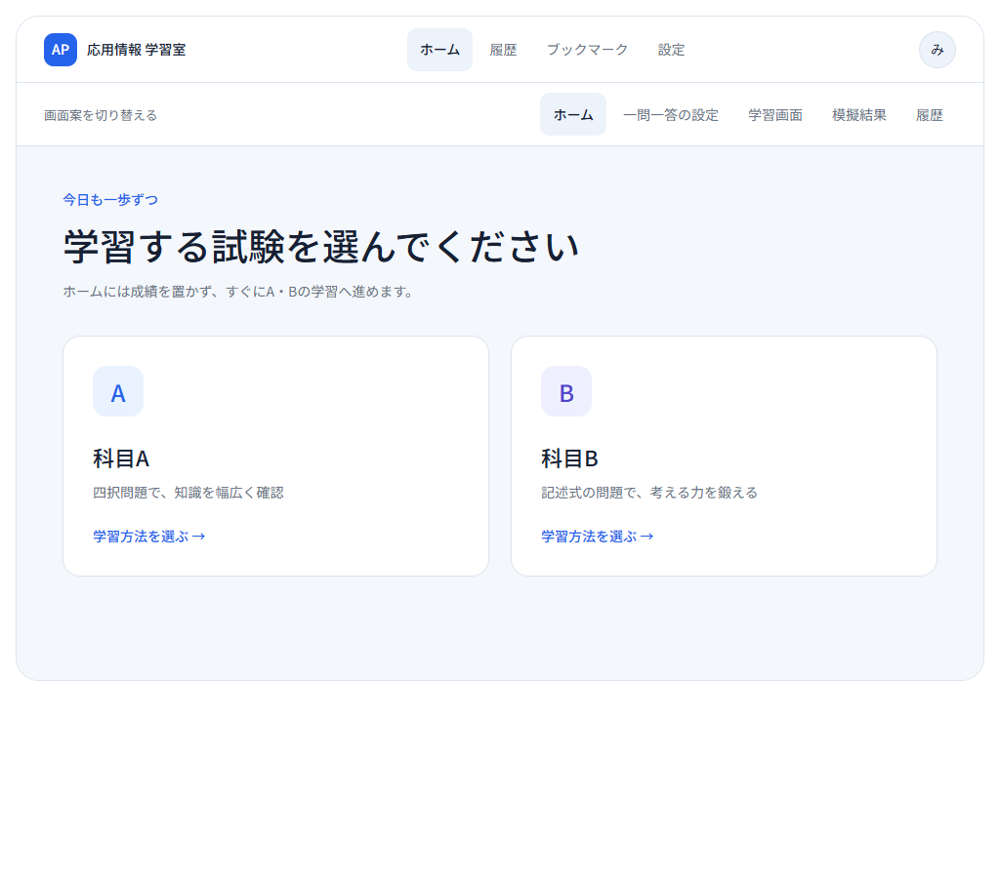
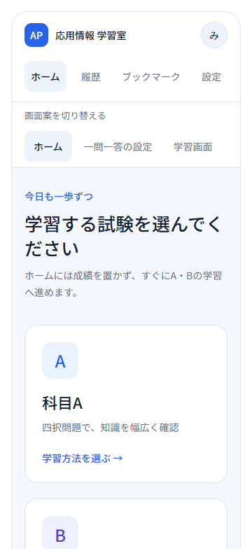
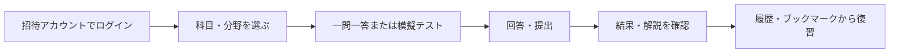
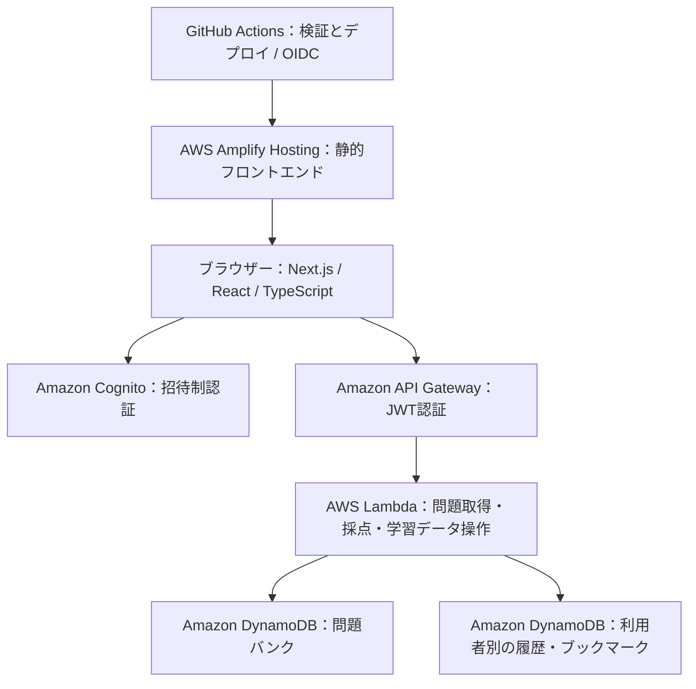

# AP Study App｜応用情報 学習室

応用情報技術者試験の学習を題材に、**画面の実装から認証・API・データ保存・AWSへの公開まで**を学ぶために制作している個人開発のWebアプリです。

> **開発途中の学習用プロジェクトです。** Amazon Cognitoによる招待制のため、操作にはアカウントが必要です。ログインせずに制作内容を知りたい方は、このREADMEの画面案・機能・構成図をご覧ください。公式の試験サービスではなく、試験形式や問題・採点内容の正確性を保証するものではありません。

## 制作のきっかけ

資格学習で情報分野の基礎を身につけ、長期インターンで業務アプリ開発を経験する中で、アプリのコードだけでなく、認証やデータ保存、公開の仕組みも理解したいと考えました。

そこで、自分の応用情報の学習を題材にAWSを独学し、フロントエンドとバックエンドをつないでサービスを公開するところまで取り組みました。ユーザーごとのデータ管理や、継続的に変更を公開する仕組みも学んでいます。

## 画面イメージ（ログイン不要）

以下は**制作初期のプロトタイプのキャプチャ**です。現在の実装画面とは一部異なり、稼働中のサービスにログインして撮影したものではありません。実装している機能は次の節をご覧ください。

### パソコンでのホーム画面案



### スマートフォンでの画面案



## 実装している機能

- **認証**：招待制ログイン、初回パスワード変更、パスワード再設定、本人によるパスワード変更・アカウント削除。
- **一問一答**：科目・分野・出題条件を選び、回答後に採点結果や解説を確認。
- **模擬テスト**：回答と残り時間の保存、中断・再開、提出、採点結果の確認。
- **復習**：科目別の学習履歴とブックマーク。履歴は直近30日・最大50回に制限。
- **公開の仕組み**：GitHub Actionsで検証後、Amplify Hostingへデプロイ。

問題バンクには本アプリ独自の学習問題を収録しています。公式過去問をそのまま収録したものではありません。問題や採点内容の妥当性は引き続き改善する対象です。

### 学習の流れ



## システム構成



インフラはAWS CDK（TypeScript）で定義しています。認証・API・データベースのスタックと、ホスティング・デプロイ用のスタックを分けています。

## 工夫したこと・学んだこと

### API側でも利用者を確認する

Cognitoの招待制ログインを導入し、API GatewayでもJWTを検証します。学習データを利用者ごとに分け、メールアドレスやパスワードを学習データベースに保存しない構成にしています。

### 正解を回答前にブラウザーへ渡さない

問題と正解のデータを分け、回答・提出後にサーバー側で採点する実装にしました。フロントエンドとバックエンドの役割を分けることを学びました。

### 公開後の変更も考える

GitHub Actionsによる検証とデプロイを構成しました。AWSへの接続にはGitHub OIDCを使い、長期アクセスキーをリポジトリに置かない方式を採用しています。実装に加え、ビルド・テスト・公開までの流れに取り組みました。

## 現在の状態と今後の改善

- 個人学習用として制作・改善中です。一般向けの新規登録や公開デモアカウントは提供していません。
- AWSへのデプロイを経験していますが、常時稼働や継続的なサービス提供を保証する公開サービスではありません。
- 問題・解説・採点内容の見直し、実際の利用を通じた画面の改善、使い方が伝わる資料の整備を続けます。
- ソースコードと本READMEの閲覧にはログインは不要です。

## 技術

| 領域 | 使用技術 |
| --- | --- |
| フロントエンド | Next.js、React、TypeScript、Tailwind CSS |
| 認証 | Amazon Cognito、AWS Amplify Auth |
| API・処理 | Amazon API Gateway、AWS Lambda（Node.js） |
| データ保存 | Amazon DynamoDB |
| ホスティング | AWS Amplify Hosting |
| インフラ管理・CI/CD | AWS CDK、GitHub Actions、GitHub OIDC |

## コードの案内

- [`src/app/`](src/app/)：ログイン、学習、結果、履歴、設定などの画面。
- [`src/lib/api-client.ts`](src/lib/api-client.ts)：認証トークンを付けたAPI呼び出し。
- [`infra/lib/infra-stack.ts`](infra/lib/infra-stack.ts)：Cognito・API Gateway・Lambda・DynamoDBの定義。
- [`infra/lib/api-handler.ts`](infra/lib/api-handler.ts)：APIの処理。
- [`infra/lib/hosting-stack.ts`](infra/lib/hosting-stack.ts)：Amplify Hostingとデプロイ用権限。
- [`.github/workflows/ci-deploy.yml`](.github/workflows/ci-deploy.yml)：検証と公開のワークフロー。
- [`docs/`](docs/)：要件、画面遷移、データ設計。設計時点の内容も含み、実装と差異がある場合はコードを参照してください。

## ローカルで動かす

Node.js 22とnpmを使用します。学習機能の動作には、自分のAWS環境と招待アカウントが必要です。

```bash
npm ci
cp .env.example .env.local
# .env.local に自分のCognito・APIの設定を記入
npm run dev
```

`http://localhost:3000` を開きます。`.env.local` はGit管理対象外です。パスワード・トークン・AWSの認証情報をコミットしないでください。

インフラを作成する場合は [`infra/README.md`](infra/README.md) とコードを確認し、自己管理のAWSアカウントで差分・権限・料金を確認してから実行してください。

## 検証コマンド

```bash
npm run lint
npm run validate:questions
npm run build
cd infra
npm ci
npm test -- --runInBand
npm run build
npm run cdk -- synth --quiet
```

`main` への変更はワークフローの検証に通った後にデプロイされます。接続先やデプロイ用設定は、自分の環境のGitHub Actions Variables等に設定する構成です。
